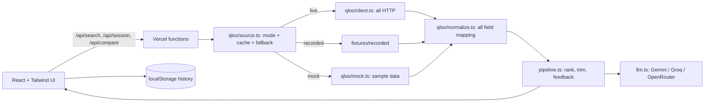

# Echoes

Echoes helps family caregivers and care-home staff plan gentle 30-minute **reminiscence sessions** (music, film and TV conversations) for people living with memory loss. The caregiver enters a few favourites from the person's younger years. Echoes asks the [Qloo](https://qloo.com) taste graph what else fits, builds a calm session plan, and learns from how each moment lands.

Built for the Qloo Agentic Hackathon. Echoes is **not medical software**: it makes no diagnosis or health claims.

## How Qloo powers it

Qloo is the reason the app is useful, not decoration:

- **Recommendations and ranking** come from Qloo insights (`/v2/insights`) seeded with the favourites. Code dedupes, removes the seeds, applies exclusions and keeps the top 5 per domain by affinity.
- **"Because of" reasons** come from Qloo explainability, mapped only to names of favourites that were actually sent as signals.
- **The learning loop** is Qloo too: loved items join `signal.interests.entities`, upsetting items go to `filter.exclude.entities` and never return.
- **The language model only words the plan.** It receives the trimmed Qloo list, may only reference item ids it was given, and the server drops anything else.
- **"With Qloo vs without"** (second tab on the session screen) asks the same model the same question with no Qloo data and then *counts*, in code, how many of its titles appear in Qloo's results. If the lists are similar it says so.

## Ask Echoes: the agent

On the session screen a caregiver can type what to change, for example *"she loved Sunday-evening ghazal radio, make it gentler"*. An AI agent then decides which Qloo tools to call, one step at a time, and picks the final items:

| Tool | Qloo call | Used for |
|---|---|---|
| `find_entity` | `/search` | Adding something the caregiver mentions |
| `find_tags` | `/v2/tags` | Turning a mood or genre ("ghazal") into tag ids |
| `recommend` | `/v2/insights` | Ranked picks for a domain, optionally restricted to a tag and an era |
| `finish` | none | Submitting the chosen ids |

Every step is shown to the user ("What Echoes did"). Guardrails are enforced in code, not in the prompt: the agent can only pick ids that Qloo actually returned, it is capped at 6 steps and about 30 seconds, tag use is limited to the hard filter that the live smoke test showed works, the instruction is treated as untrusted data, and if the agent cannot finish the standard session is returned with a note. The result is added to the history as a new session so it can be compared with the previous one. It needs the AI key; without it the panel says so and the standard session still works.

## Architecture



All Qloo HTTP lives in `client.ts`; all Qloo response-field mapping lives in `normalize.ts`. The rest of the app only sees the internal `Item` type, so fixing the mapping after the real JSON arrives is a change to `normalize.ts` only.

## Data modes (`QLOO_MODE`)

| Mode | What it does | UI badge |
|---|---|---|
| `live` | Real Qloo calls. On failure or quota exhaustion, falls back to recorded data. | Live Qloo data |
| `recorded` | Replays `fixtures/recorded/recorded.json` made by `npm run record`. | Cached from Qloo, recorded `<date>` |
| `mock` | Hand-written sample data in the assumed format. | Sample data, not live Qloo |

Default: `mock` locally, `live` on Vercel. Mock data is never presented as Qloo data.

## Setup

```bash
npm install
cp .env.example .env.local   # optional: add LLM_API_KEY (free Gemini key works)
npm run dev                  # http://localhost:5173, API served by the dev server
npm test                     # unit tests, all network mocked
npm run typecheck            # strict TypeScript for the app and for the Vercel API config
npm run build
```

Without an LLM key the plan is built from a deterministic template (the UI says so) and "With Qloo vs without" asks you to set a key.

### Environment variables

| Variable | Purpose |
|---|---|
| `QLOO_MODE` | `live`, `recorded` or `mock` |
| `QLOO_API_KEY` | Hackathon key (works only on `hackathon.api.qloo.com`) |
| `QLOO_BASE_URL` | Defaults to `https://hackathon.api.qloo.com` |
| `QLOO_MONTHLY_BUDGET` | Soft per-instance call budget (default 8000) |
| `LLM_PROVIDER` | `gemini` (default), `groq` or `openrouter` |
| `LLM_API_KEY`, `LLM_MODEL` | Provider key and optional model override |
| `RATE_LIMIT_PER_MIN` | Per-IP cap on `/api/session` and `/api/compare` (default 20) |

### Scripts

- `npm run smoke`: about 9 live calls, saves raw JSON in `fixtures/raw/`, reports which fields exist.
- `npm run record`: runs the preset personas against live Qloo and writes `fixtures/recorded/recorded.json`.
- `npm run presets`: rebuilds `src/data/presets.generated.json` (the zero-API-call preset sessions) from the active mode.
- `npm run presets:recorded`: the same, but built from `fixtures/recorded/recorded.json` (works on Windows, macOS and Linux; also set `LLM_API_KEY` to get real AI plans and a real AI-only comparison).
- Step by step after you get a key: [`scripts/POST_KEY_CHECKLIST.md`](scripts/POST_KEY_CHECKLIST.md).

## Deploy to Vercel (free tier)

1. Push this repo to GitHub (public).
2. In Vercel choose **Add New, Project**, import the repo. The Vite preset is detected; `vercel.json` sets function duration and includes the recorded fixtures.
3. Add the environment variables above (at least `QLOO_MODE`, `QLOO_API_KEY`, `LLM_API_KEY`).
4. Deploy, then open `/api/health` and check the reported mode.

## Reliability

Server LRU+TTL cache with normalised request keys and in-flight deduplication; client sessionStorage cache; outbound limiter (about 4 req/s); retry only on 429 and 5xx (two tries) then recorded fallback; per-IP request cap; per-instance call budget; zod validation on every endpoint; same-origin checks; friendly errors with a path forward.

## Privacy

No accounts, no database. History is in this browser's localStorage (Reset all data clears it). The UI asks for a nickname only. Qloo receives only public entity ids and an optional city. The LLM receives nicknames, favourite titles and an optional born-around decade.

## Known limitations

- **Partly confirmed against real responses (smoke test, October 2026):** search, insights, place and tags shapes, affinity, `release_year` for films and TV, images and explainability (`query.explainability["signal.interests.entities"]`). Also confirmed: the `filter.release_year.min/max` era parameters (films moved from 1994-2016 to 1950-1975), `filter.tags` as a hard tag filter, comma-separated search types, and place queries with favourites as signals. Not usable: `signal.interests.tags` on its own returned unrelated results, so the agent only uses tags as a hard filter.
- Qloo's film and TV picks skew modern for older tastes. Era filtering (server-side if accepted, otherwise in code) is therefore central, and when too few titles fit the era the filter is relaxed and the UI says so.
- Place suggestions are whatever Qloo ranks for the city (for example nightlife venues can appear); there is no category filter yet.
- Release years, image URLs and explainability may not exist in real responses. The era filter and "because of" chips degrade gracefully and the UI says when a filter is inactive.
- Serverless memory is per instance, so caches, the IP cap and the call budget reset on cold starts and are not shared across instances.
- The "With Qloo vs without" view counts overlap by code and checks AI-only titles against Qloo's search, so "not recommended" and "not found" are reported separately. On replayed (recorded) data that check is skipped and titles are labelled "not checked".
- Mock catalogue is small (about 75 titles); custom favourites outside it will not be found in mock mode.
- The Vercel deployment itself has not been exercised from the build sandbox.
- Era filtering applies to films and TV only; music has no reliable "recorded in" year in the assumed data.
- The preset "AI-only" comparison is a hand-written illustrative sample unless presets are rebuilt with an LLM key. It is labelled as such.

## What the results do not establish

Qloo results describe aggregate affinities: what groups with similar tastes tend to like. They say nothing certain about what one person will enjoy, and nothing about their health. Echoes treats every suggestion as a conversation starter, and the caregiver's ratings, not the data, decide what comes next.

## Licence

MIT, see [LICENSE](LICENSE). Taste data: Qloo Taste AI.
